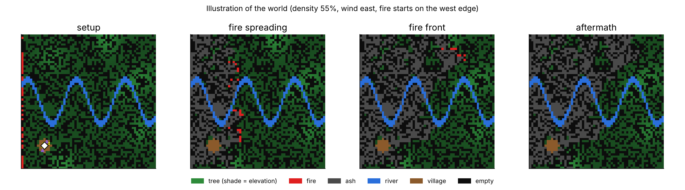
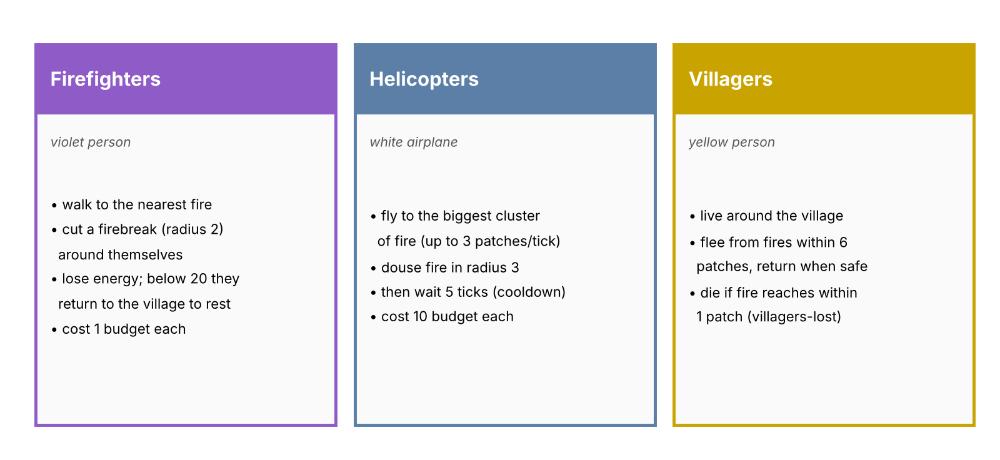
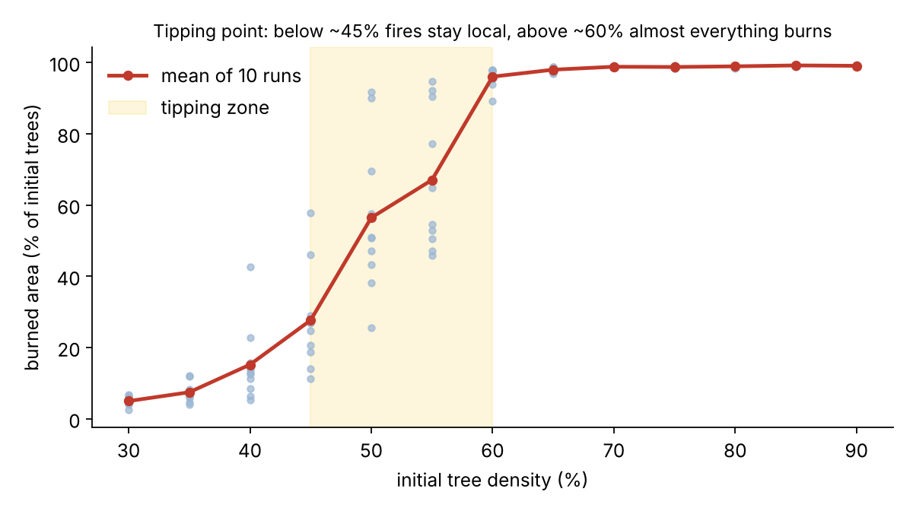
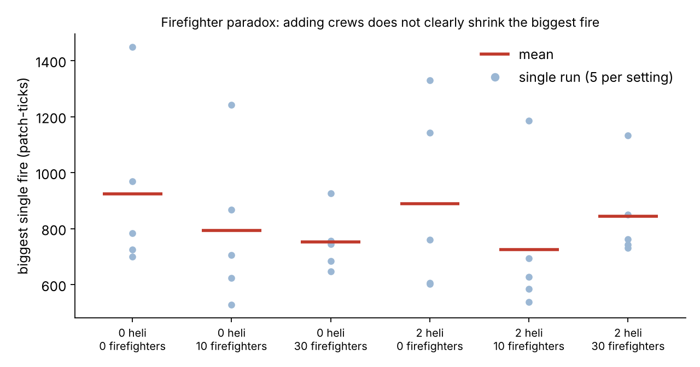

# 🔥 Firefighter Paradox — NetLogo Wildfire Agent-Based Model

An agent-based model built in **NetLogo 7.0.4** that simulates wildfire spreading through a forest with a village, firefighters, helicopters and villagers. It is used to study two questions:

1. **Tipping point:** at what tree density does a fire stop being local and burn almost the whole forest?
2. **Firefighter paradox:** does adding more firefighters/helicopters actually reduce the biggest fire?



*Illustration generated from the model's rules (not a NetLogo screenshot). See [Add real screenshots](#add-real-screenshots) to replace it.*

## Repository structure

```
netlogo-firefighter/
├── README.md
├── models/
│   ├── firefighter/firefighter.nlogox   ← main model (open this)
│   └── smart-city/smart_city.nlogox     ← separate Smart City growth model
├── data/                                ← BehaviorSpace experiment output
├── images/                              ← figures used in this README
└── archive/                             ← earlier versions of the firefighter model
```

## How to run

1. Install [NetLogo 7.0.4](https://www.netlogo.org/) (or newer).
2. Open `models/firefighter/firefighter.nlogox` in NetLogo.
3. Press **setup**, then **go** (runs forever; press again to stop).
4. Watch the monitors and plots, and move the sliders to experiment.

To rerun the experiments: **Tools → BehaviorSpace**, pick `TippingPoint` or `FirefighterParadox`, and click **Run**. Results are written as CSV.

## The world

| Patch state | Colour | Meaning |
|---|---|---|
| tree | green (darker = lower elevation) | can catch fire |
| fire | red | burns for one tick, then becomes ash |
| ash | grey | burned; regrows into a tree at `regrowth-rate` |
| empty | black | bare ground; can regrow |
| water | blue | a sine-wave river; fire cannot cross |
| break | light blue | firefighter-cut firebreak; reverts to empty slowly |
| village | brown | home base at (-20, -20) |

Terrain is randomly generated hills. Fire spreads faster uphill and downwind, is slowed by humidity, and the east side (x > 15) is more flammable (×1.4).

## The agents



## Controls

| Control | Default | Range | Effect |
|---|---|---|---|
| `density` | 34 | 0–100 | % of land that starts as trees |
| `num-firefighters` | 11 | 0–50 | firefighter agents (cost 1 each) |
| `num-helicopters` | 1 | 0–10 | helicopter agents (cost 10 each) |
| `budget` | 100 | 0–100 | caps how many crews can be afforded |
| `wind-speed` | 5 | 0–20 | stronger wind = faster downwind spread |
| `wind-direction` | 0 | 0–359 | direction the wind blows towards (0 = north) |
| `humidity` | 30 | 0–100 | higher = fire spreads less |
| `lightning-rate` | 3 | 0–20 | % chance per tick of a random lightning strike |
| `camper-rate` | 1 | 0–20 | % chance per tick of a fire near the village |
| `regrowth-rate` | 0.1 | 0–1 | % chance per tick that ash/empty becomes a tree |
| `initial-fire?` | off | switch | start with the whole west edge burning |

**Monitors/plots:** burned %, tree density, biggest fire, fires so far, villagers lost; plots for burned area, tree density and fire-size distribution.

## Experiments and results

### 1. Tipping point (`TippingPoint`)

10 runs per density, 1500 ticks, no wind, fire started on the west edge.



Below ~40% density the fire stays small (about 5–15% burned). Between 45% and 60% results are very mixed, and from 60% upward about 97–99% of the forest burns: a classic percolation-style tipping point.

### 2. Firefighter paradox (`FirefighterParadox`)

5 runs per setting, 2000 ticks, with lightning and campers igniting fires.



More crews do not give a clear drop in the biggest fire; run-to-run randomness is larger than the effect of the crew size. Fighting small fires also lets fuel accumulate, so rarer fires can grow large (the "paradox"). With these settings very few villagers were lost.

## Data files

| File | Contents |
|---|---|
| `data/tipping_point_results.csv` | BehaviorSpace output: burned % vs. density |
| `data/firefighter_paradox_results.csv` | BehaviorSpace output: biggest fire, tree density, villagers lost |
| `data/firefighter_paradox_results.xlsx` | Same results in Excel |
| `data/firefighter_paradox_TEMPLATE.csv` | Template layout used for planning/analysis |

## Smart City model (separate)

`models/smart-city/smart_city.nlogox` is a second, independent NetLogo model of autonomous urban growth (people, houses, businesses, developers, cars, pollution and land value; one tick = one day, city updates monthly). It needs the shapes `building store` and `building institution` (Tools → Turtle Shapes Editor → Import from Library).

## Add real screenshots

In NetLogo, run the model, then **File → Export View…** (or **Export Interface…**) and save the PNG into `images/`. Reference it in this README with ``.

## Version history

The `archive/` folder holds earlier iterations of the firefighter model (`v1`, `v2`, `v4`, `v5_copy`). The main model is the version that contains the BehaviorSpace experiments.

## Author

binarybrains333
